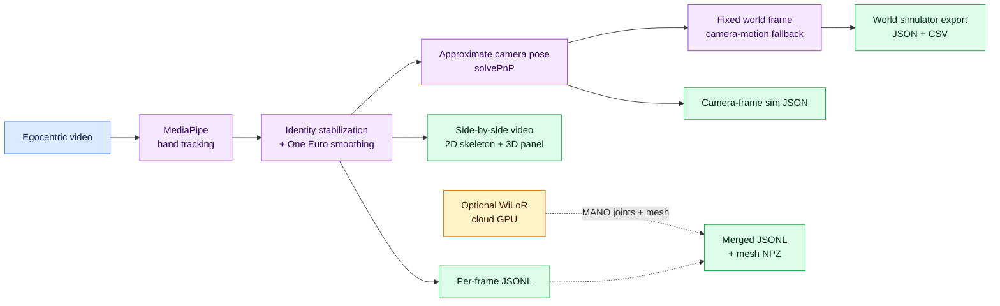
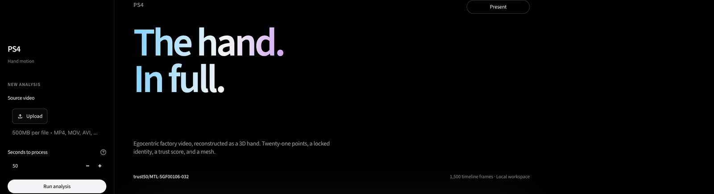
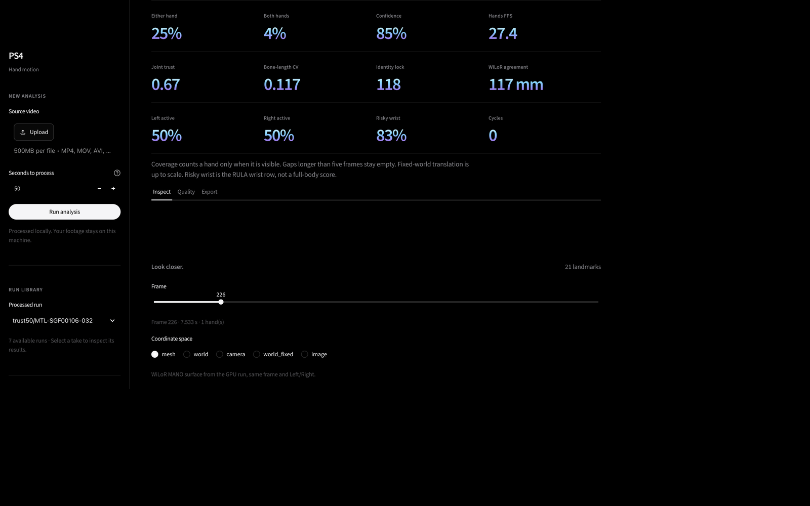
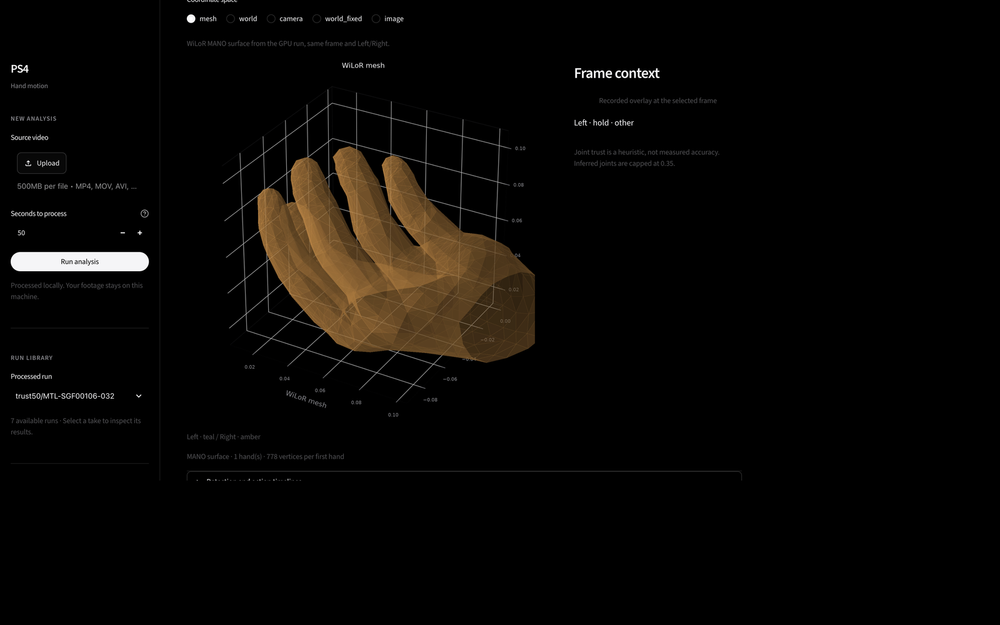
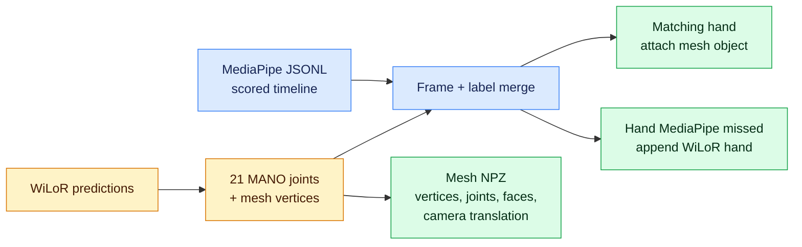

# TouchTrace / PS4 — egocentric hand tracking (BIOS V2, Problem Statement 2)

Track left and right hands with MediaPipe Hand Landmarker (VIDEO mode), stabilize identity across frames with IoU and center-distance matching, smooth landmarks with One Euro filtering, and export per-frame JSONL plus operational metrics. Optional side-by-side visualization and sim export remain unchanged.

Plan: [Notion — PS4 (24h)](https://www.notion.so/40aa9a9820cb818dbed3e37e150f2161)

## System at a glance



The primary scored timeline is MediaPipe. WiLoR adds higher-fidelity MANO geometry without replacing the MediaPipe landmarks.

## Data rules

Hackathon use only. Do not publish clips, frames, or screenshots. Do not commit video. `data/raw/` and `outputs/` are gitignored.

## Get the project running

Clone the repo, create a virtual environment, install dependencies, download the MediaPipe model, then run a clip. Video stays in `data/raw/` and is never committed.

```bash
git clone https://github.com/diksha13555/Bios-Ps4.git
cd Bios-Ps4
```

Put one MP4 at `data/raw/your_clip.mp4`.

### macOS or Linux

Python 3.11 is what this repo was developed with. Python 3.10 also works.

```bash
python3.11 -m venv .venv
source .venv/bin/activate
python -m pip install --upgrade pip
python -m pip install -r requirements.txt
bash scripts/download_models.sh
python -m pytest -q
python scripts/run_ps4.py --input data/raw/your_clip.mp4
```

### Windows (including an NVIDIA laptop)

Use Python 3.10 so the optional WiLoR install matches the version it was tested with. Install Python from python.org with “Add python.exe to PATH” checked, plus Git for Windows.

```powershell
py -3.10 -m venv .venv
.\.venv\Scripts\Activate.ps1
python -m pip install --upgrade pip
python -m pip install -r requirements.txt
New-Item -ItemType Directory -Force models
Invoke-WebRequest -Uri "https://storage.googleapis.com/mediapipe-models/hand_landmarker/hand_landmarker/float16/1/hand_landmarker.task" -OutFile "models\hand_landmarker.task"
python -m pytest -q
python scripts\run_ps4.py --input data\raw\your_clip.mp4
```

If PowerShell blocks activation, run `Set-ExecutionPolicy -Scope Process -ExecutionPolicy Bypass` in that window and activate again.

The sample clips are HEVC. OpenCV on Windows often cannot decode that. Install ffmpeg and transcode the clip you will run:

```powershell
winget install Gyan.FFmpeg
ffmpeg -i data\raw\your_clip.mp4 -c:v libx264 -crf 18 -c:a copy data\raw\your_clip-h264.mp4
python scripts\run_ps4.py --input data\raw\your_clip-h264.mp4
```

A short test is `--max-frames 300`.

### Deploy the workbench (Streamlit Cloud)

**Vercel only hosts the static landing page** (`index.html` at [touchtrace-six.vercel.app](https://touchtrace-six.vercel.app)). The **Streamlit workbench must run on Streamlit Community Cloud, Render, or your own server** — Vercel cannot keep a Python Streamlit process alive.

1. Sign in at [share.streamlit.io](https://share.streamlit.io/) with GitHub.
2. **New app** → repository `diksha13555/Bios-Ps4`, branch `main`.
3. **Main file path:** `streamlit_app.py` (bootstraps folders and downloads the Hand Landmarker model on first boot).
4. Deploy. Your app URL will look like `https://<name>.streamlit.app`.
5. Optional: in `index.html`, set the **Open studio** link to that URL, or use **Render** with the included `render.yaml` (Blueprint → New → Blueprint).

Cloud notes: CPU-only; keep **Seconds to process** small for demos (e.g. 30–50). Uploaded videos and `outputs/` are ephemeral on free tiers. WiLoR mesh still requires a separate GPU run locally.

### Open the TouchTrace dashboard (local)

From the repo root, with the virtual environment activated:

```bash
streamlit run streamlit_app.py
# or: streamlit run app/workbench.py
```

On Windows:

```powershell
streamlit run app\workbench.py
```

Open [http://localhost:8501](http://localhost:8501). The hero shows **TouchTrace** in the top-left brand. The page loads the processed run that has a scorecard. **Present** hides the sidebar for the judging view.

The sidebar is where a new clip is run. Choose an MP4, MOV, AVI, or MKV, set **Seconds to process** (`0` means the whole file), and press **Run analysis**. The MediaPipe model from the setup steps has to be on disk first. The upload is saved in `data/raw/`. The side-by-side video, JSONL, report, and sim files are written to `outputs/`. Both folders stay off GitHub. One minute of video takes a few minutes on CPU.



Under the video, the spec strip shows detection, trust, identity lock, WiLoR agreement, hand balance, wrist risk, and cycles. **Inspect** is the frame scrubber. **Quality** is the longer scorecard. **Export** downloads the report, JSONL, and world-frame files.



To see the mesh, stay on **Inspect**, move the frame slider onto a frame that has a hand, and leave **Coordinate space** on **mesh**. That surface is the saved WiLoR result (778 vertices per hand). **world**, **camera**, and **world_fixed** switch the same frame to the other coordinate systems. The pictures below are the interface and the reconstructed mesh. They are not frames from the source video.



### Optional WiLoR mesh (NVIDIA GPU)

WiLoR is a second pass. It needs an NVIDIA GPU, about 6 GB of VRAM, and Python 3.10. Close other GPU apps first. `nvidia-smi` should show the card before you install.

```powershell
python -m pip install torch torchvision --index-url https://download.pytorch.org/whl/cu121
python -m pip install "git+https://github.com/warmshao/WiLoR-mini"
python -c "import torch; print(torch.cuda.is_available(), torch.cuda.get_device_name(0))"
python scripts\run_mesh.py --input data\raw\your_clip-h264.mp4 --max-frames 60 --merge outputs\your_clip-h264.jsonl
```

The print must say `True` and the GPU name. The first run downloads weights from Hugging Face. Drop `--max-frames 60` for the full clip. If the process runs out of memory, rerun with `--stride 2`.

On Linux, `bash scripts/setup_mesh_gpu.sh` does the same install.

## Run outputs

```powershell
python scripts/run_ps4.py --input data/raw/your_clip.mp4
```

| Output | Description |
| --- | --- |
| `<name>_sidebyside.mp4` | Source + 2D skeleton beside 3D hand plot |
| `<name>.jsonl` | Per-frame landmarks (image, world, optional camera, optional world_fixed) |
| `<name>_report.json` | **Operational** metrics: FPS, detection share, dropouts, jitter, world stats, `accuracy` slide summary |
| `<name>_sim.json` | Wrist 6-DoF and finger curl angles for sim |
| `<name>_world_sim.json` | Fixed-world wrist trajectories (smoothed) + finger curls |
| `<name>_world_sim.csv` | Flat CSV of the same world trajectories for simulators |

**Side-by-side render layout**

```text
┌────────────────────────────────┬────────────────────────────────┐
│ SOURCE + 2D SKELETON           │ 3D HAND PANEL                  │
│ Left/right labels + FPS HUD    │ Camera or world landmarks      │
│ Tracked + interpolated hands   │ 21 joints + bone connections   │
└────────────────────────────────┴────────────────────────────────┘
```

The 3D hand panel automatically fits the 21 landmarks, thickens the skeleton, and uses a display-only `1.25x` zoom. Increase it with `--world-zoom 1.5` (clamped to `1.0-2.0`). Zoom never changes the exported metric coordinates.

For difficult egocentric footage, use the slower high-accuracy preset:

```bash
python scripts/run_ps4.py --input data/raw/your_clip.mp4 --high-accuracy --max-frames 300
```

This raises detector input to at least 1920 px, widens ROI recovery, and uses recall-oriented thresholds. It can improve detection coverage and dropouts at the cost of FPS; it does not replace ground-truth accuracy evaluation.

Other useful flags: `--max-frames 300`, `--no-clahe`, `--viz-max-side 960`, `--no-camera-pose`, `--max-gap 5`, `--no-world`, `--world-smooth-window 11`, `--min-detection-confidence 0.4` (recall vs precision).

## JSONL output format

One JSON object per line:

```json
{
  "frame": 0,
  "t_sec": 0.0,
  "hands": [
    {
      "label": "Left",
      "score": 0.91,
      "tracked": true,
      "interpolated": false,
      "image": [[x, y, z], "... 21 landmarks ..."],
      "world": [[x, y, z], "... 21 landmarks ..."],
      "camera": null,
      "reproj_error_px": null
    }
  ]
}
```

Coordinates: `image` x/y are normalized to frame width/height in `[0, 1]`.

## Ground-truth annotation format

Label only frames you have manually annotated. Omit all other frames (they are excluded from accuracy metrics).

```json
{"frame": 12, "hands": [{"label": "Left", "image": [[0.42, 0.31, 0.0], "... 21 points ..."]}]}
{"frame": 13, "hands": []}
```

- `label`: `"Left"` or `"Right"` (annotator’s subject handedness).
- `image`: 21 landmarks in the same normalized space as pipeline output (z optional).
- Empty `hands`: negative example (no hand visible).

Do not generate labels from model output.

## Accuracy evaluation

```powershell
python scripts/evaluate_hands.py `
  --predictions outputs/your_clip.jsonl `
  --labels data/labels/your_clip.jsonl `
  --operational-report outputs/your_clip_report.json `
  --report outputs/your_clip_eval.json
```

### Metrics

| Block | Metric | Meaning |
| --- | --- | --- |
| **detection** | precision / recall / detection_rate | Spatial wrist matching; **labels ignored** for TP/FP/FN |
| **landmarks** | mean_error_norm | Mean L2 error on x,y for matched pairs with 21 GT points |
| **landmarks** | pck | Fraction of keypoints within `--pck-threshold` (default 0.05 norm) |
| **handedness** | accuracy | Label agreement on **spatially matched** pairs only |
| **tracking** | identity_label_switches | Prediction label changes for the same GT hand across labelled frames |
| **operational** | (from `_report.json`) | FPS, detection share, dropouts, mean confidence, world speed — **not** ground-truth accuracy |

If no annotation file exists, the evaluator exits with a clear message and does not report fabricated accuracy.

The `_report.json` **`accuracy`** block is operational (confidence, coverage, pitch text), not ground-truth landmark accuracy.

## Pipeline

MediaPipe Hand Landmarker (VIDEO mode) with CLAHE preprocessing, IoU plus center-distance identity tracking (not raw handedness), One Euro smoothing, gap fill up to 5 frames, optional `solvePnP` camera-frame landmarks, fixed world frame, and Matplotlib 3D rendering.

## Trust, actions, and the scorecard

After tracking, each of the 21 joints gets a trust value from 0 to 1. It combines the MediaPipe score, per-joint reprojection error, how fast that joint is jittering, and, when a WiLoR mesh is attached, how far the two estimates disagree. Inferred frames are capped at 0.35.

Bone lengths are taken from the trusted frames. Low-trust joints are pulled back to those lengths, and a finger that curls past a hard stop is folded back. That is the blur and glove cleanup. One Euro smoothing also backs off when the hand score is low, and a second pass smooths low-trust joints more than high-trust ones.

Gaps of at most 5 frames are filled from the frames on either side. Motion history is used only when it agrees with that fill. Longer gaps stay empty. Filled frames are marked `inferred`.

Wrist speed and finger curl then label each frame as idle, reach, grasp, hold, or release. A grasp or hold also gets a coarse Feix-style name: power, precision, lateral, or other. The report's `factory` block turns those segments into cycle time, left/right balance, a RULA-style wrist score, and a smoothness number. `scorecard` reports bone-length stability, Left/Right disagreements, MediaPipe versus WiLoR agreement, and world-frame drift between a release and the next grasp.

`joint_confidence`, `action`, and `grasp` are written into the JSONL, the sim JSON, and the world CSV. A downstream robot can ignore the low-trust frames.


## Fixed world frame + simulator export

On by default when camera pose is enabled (`--no-world` disables). A camera-motion
fallback estimates ego-motion with monocular visual odometry: LK feature tracking
on the background (tracked hands are masked out), `findEssentialMat` + `recoverPose`,
and per-frame pose composition. Rotation-dominant/low-parallax frames (where
`recoverPose` fails cheirality) fall back to homography-decomposition rotation
with no translation update. Failed frames carry the last pose forward and are
marked `valid=False`.


**Coordinate convention**

```text
                       +z forward
                          ↗
                         /
World = frame 0 camera  o ───────→ +x right
                        │
                        ↓
                     +y down
```

- World frame = camera at frame 0. Axes: +x right, +y down, +z forward (OpenCV).
- Rotation is exact; **translation is up-to-scale** (monocular scale ambiguity).
  Treat world positions as a consistent trajectory shape, not metric ground truth.
- Each hand gains `world_fixed` (21 joints) in the JSONL; each frame gains
  `camera_pose_world` (rotation, translation, valid).
- Wrist trajectories are smoothed (savgol on positions; sign-aligned savgol +
  renormalize on quaternions; small gaps lerp/Slerp-filled). The 21-joint
  `world_fixed` stays raw so the hand never deforms; only the exported wrist
  trajectory is smoothed.
- `<name>_world_sim.json` adds per-hand `wrist_xyz`, `wrist_quat_xyzw`,
  `finger_curls_rad` (rigid-invariant), `tracked`/`interpolated`/`smoothed`, plus
  `coordinate_frame` metadata. `<name>_world_sim.csv` is the flat row-per-hand
  version for direct simulator ingestion.

HaWoR is the optional heavier alternative to the fallback (same role as WiLoR for
mesh): a future GPU runner can supply its own per-frame camera trajectory to
`attach_world`, or write world-space hands directly into `world_fixed`, reusing
this export path unchanged.

## Hand-anchored scale and contact grounding

On by default with the world stage (`--no-ground` disables). The operator's own
hand calibrates the scene, which removes the monocular up-to-scale caveat
*approximately* instead of ignoring it:

1. **Ego-scale from anthropometry.** Trusted bone lengths (metacarpals, proximal
   and intermediate phalanges) are compared with adult anthropometric means to
   get a per-clip hand-size scale. MediaPipe's nominal hand units are typically
   15–25% undersized.
2. **Trajectory scale from contacts.** During a grasp/hold the hand is stationary
   in the world, so the camera translation step equals the hand's apparent step
   in the camera frame. The median ratio scales the whole VO trajectory.
3. **Contact anchoring.** Each grasp/hold run (≥ ~0.1 s, one-frame flickers
   merged) pins the wrist to its median position — a hand holding an object
   cannot drift. Raw `world_fixed` is never mutated; corrected joints go to
   `world_grounded` (21 joints, rigid per-frame offset, hand shape preserved).

The scorecard then reports `world_drift` (raw) next to `world_drift_grounded`
(after anchoring). On the bundled sample the release→grasp gap drops from
~0.58 to ~0.007 (approximate meters; the raw value is up-to-scale, so treat the
pair as relative improvement). World exports gain `wrist_xyz_grounded_m` and the
CSV gains `gx, gy, gz` columns. All scale values and anchors land in the
report's `grounding` block, labeled heuristic.

## TouchTrace quality score

Every hand-frame gets a 0–1 `quality` score answering *"how much should you
trust this reconstruction?"* — the project's headline honesty layer:

| Component | Weight | What it measures |
|---|---|---|
| trust | 0.30 | Mean per-joint confidence |
| bone | 0.20 | Bone-length stability inside the action segment |
| identity | 0.15 | MediaPipe raw Left/Right agreeing with the locked identity |
| world | 0.20 | Visual-odometry validity and feature inliers |
| plausibility | 0.15 | No impossible action transitions or curl teleports |

The report's `touchtrace` block carries the overall score, an A/B/C/D grade,
component means, and per-action-segment scores (worst segments are the ones to
re-film). `quality` flows into the JSONL, world sim JSON/CSV, and the
workbench header. It is a composite heuristic, not ground-truth accuracy.

## 3D mesh (WiLoR, cloud GPU)

WiLoR detects the hand and returns 21 MANO joints plus a mesh. Joints are written in the same per-frame JSONL as MediaPipe. Vertices go to `<name>_mesh.npz` (`mesh_index` on each hand). `--merge` attaches a `mesh` object onto the matching MediaPipe hand and appends hands MediaPipe missed.



```bash
bash scripts/setup_mesh_gpu.sh
python scripts/run_mesh.py --input data/raw/your_clip.mp4 --merge outputs/your_clip.jsonl
```

HaMeR is the heavier alternate (separate detector, own install). This runner uses WiLoR because one pass already yields joints and mesh. Python 3.10 on the GPU machine is the version WiLoR-mini tests.

**Mirrored labels:** `src/mirrored_label.py` is a documented hook. The hackathon PDF is not in-repo; **no Left/Right swap is applied** until the spec is confirmed.

## Limitations

- No labelled evaluation video is bundled; real accuracy numbers require your annotation JSONL.
- Live track hold (`HandRuntime`) uses `max_gap=10`; export gap fill uses CLI `--max-gap` (default 5).
- MediaPipe world landmarks are hand-centric meters, not a factory frame.
- End-to-end video pipeline was not run in CI without `data/raw/*.mp4` and `models/hand_landmarker.task`.

## Test results (last run)

Run `pytest -q` after `pip install -r requirements.txt`. The merged tree includes world/mesh tests plus identity and ground-truth evaluation tests (synthetic fixtures only).
