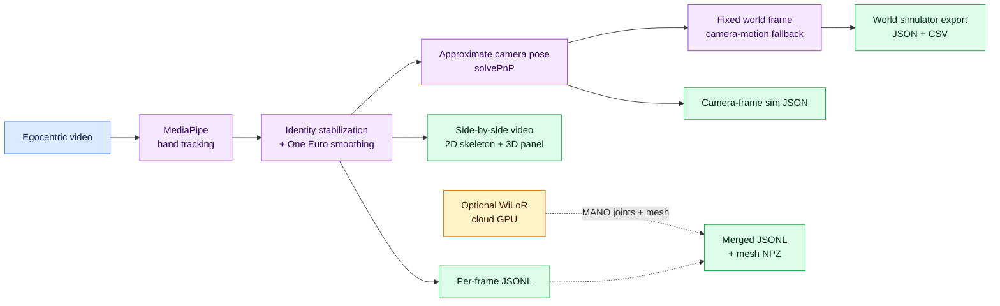
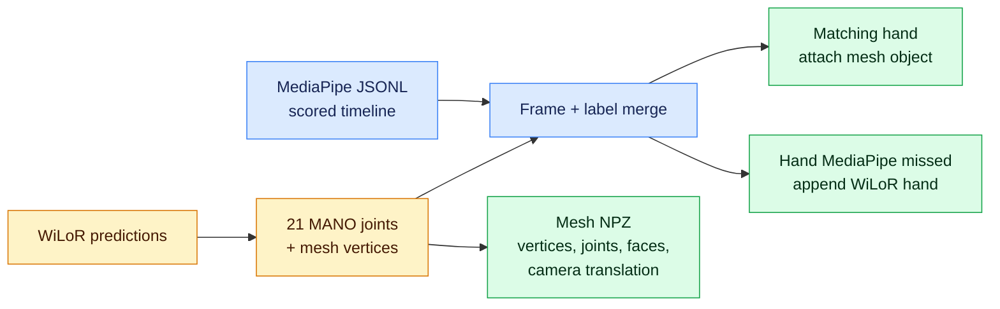

# TouchTrace / PS4 — egocentric hand tracking (BIOS V2, Problem Statement 2)

Track left and right hands with MediaPipe Hand Landmarker (VIDEO mode), stabilize identity across frames with IoU and center-distance matching, smooth landmarks with One Euro filtering, and export per-frame JSONL plus operational metrics. Optional side-by-side visualization and sim export remain unchanged.

Plan: [Notion — PS4 (24h)](https://www.notion.so/40aa9a9820cb818dbed3e37e150f2161)

## System at a glance



The primary scored timeline is MediaPipe. WiLoR adds higher-fidelity MANO geometry without replacing the MediaPipe landmarks.

## Data rules

Hackathon use only. Do not publish clips, frames, or screenshots. Do not commit video. `data/raw/` and `outputs/` are gitignored.

## Get the project running

Clone the repo, create a virtual environment, install dependencies, download the MediaPipe model, then run a clip. Video stays in `data/raw/` and is never committed.

```bash
git clone https://github.com/diksha13555/Bios-Ps4.git
cd Bios-Ps4
```

Put one MP4 at `data/raw/your_clip.mp4`.

### macOS or Linux

Python 3.11 is what this repo was developed with. Python 3.10 also works.

```bash
python3.11 -m venv .venv
source .venv/bin/activate
python -m pip install --upgrade pip
python -m pip install -r requirements.txt
bash scripts/download_models.sh
python -m pytest -q
python scripts/run_ps4.py --input data/raw/your_clip.mp4
```

### Windows (including an NVIDIA laptop)

Use Python 3.10 so the optional WiLoR install matches the version it was tested with. Install Python from python.org with “Add python.exe to PATH” checked, plus Git for Windows.

```powershell
py -3.10 -m venv .venv
.\.venv\Scripts\Activate.ps1
python -m pip install --upgrade pip
python -m pip install -r requirements.txt
New-Item -ItemType Directory -Force models
Invoke-WebRequest -Uri "https://storage.googleapis.com/mediapipe-models/hand_landmarker/hand_landmarker/float16/1/hand_landmarker.task" -OutFile "models\hand_landmarker.task"
python -m pytest -q
python scripts\run_ps4.py --input data\raw\your_clip.mp4
```

If PowerShell blocks activation, run `Set-ExecutionPolicy -Scope Process -ExecutionPolicy Bypass` in that window and activate again.

The sample clips are HEVC. OpenCV on Windows often cannot decode that. Install ffmpeg and transcode the clip you will run:

```powershell
winget install Gyan.FFmpeg
ffmpeg -i data\raw\your_clip.mp4 -c:v libx264 -crf 18 -c:a copy data\raw\your_clip-h264.mp4
python scripts\run_ps4.py --input data\raw\your_clip-h264.mp4
```

A short test is `--max-frames 300`.

### Optional WiLoR mesh (NVIDIA GPU)

WiLoR is a second pass. It needs an NVIDIA GPU, about 6 GB of VRAM, and Python 3.10. Close other GPU apps first. `nvidia-smi` should show the card before you install.

```powershell
python -m pip install torch torchvision --index-url https://download.pytorch.org/whl/cu121
python -m pip install "git+https://github.com/warmshao/WiLoR-mini"
python -c "import torch; print(torch.cuda.is_available(), torch.cuda.get_device_name(0))"
python scripts\run_mesh.py --input data\raw\your_clip-h264.mp4 --max-frames 60 --merge outputs\your_clip-h264.jsonl
```

The print must say `True` and the GPU name. The first run downloads weights from Hugging Face. Drop `--max-frames 60` for the full clip. If the process runs out of memory, rerun with `--stride 2`.

On Linux, `bash scripts/setup_mesh_gpu.sh` does the same install.

## Run outputs

```powershell
python scripts/run_ps4.py --input data/raw/your_clip.mp4
```

| Output | Description |
| --- | --- |
| `<name>_sidebyside.mp4` | Source + 2D skeleton beside 3D hand plot |
| `<name>.jsonl` | Per-frame landmarks (image, world, optional camera, optional world_fixed) |
| `<name>_report.json` | **Operational** metrics: FPS, detection share, dropouts, jitter, world stats, `accuracy` slide summary |
| `<name>_sim.json` | Wrist 6-DoF and finger curl angles for sim |
| `<name>_world_sim.json` | Fixed-world wrist trajectories (smoothed) + finger curls |
| `<name>_world_sim.csv` | Flat CSV of the same world trajectories for simulators |

**Side-by-side render layout**

```text
┌────────────────────────────────┬────────────────────────────────┐
│ SOURCE + 2D SKELETON           │ 3D HAND PANEL                  │
│ Left/right labels + FPS HUD    │ Camera or world landmarks      │
│ Tracked + interpolated hands   │ 21 joints + bone connections   │
└────────────────────────────────┴────────────────────────────────┘
```

Useful flags: `--max-frames 300`, `--no-clahe`, `--viz-max-side 960`, `--no-camera-pose`, `--max-gap 5`, `--no-world`, `--world-smooth-window 11`, `--min-detection-confidence 0.4` (recall vs precision).

## JSONL output format

One JSON object per line:

```json
{
  "frame": 0,
  "t_sec": 0.0,
  "hands": [
    {
      "label": "Left",
      "score": 0.91,
      "tracked": true,
      "interpolated": false,
      "image": [[x, y, z], "... 21 landmarks ..."],
      "world": [[x, y, z], "... 21 landmarks ..."],
      "camera": null,
      "reproj_error_px": null
    }
  ]
}
```

Coordinates: `image` x/y are normalized to frame width/height in `[0, 1]`.

## Ground-truth annotation format

Label only frames you have manually annotated. Omit all other frames (they are excluded from accuracy metrics).

```json
{"frame": 12, "hands": [{"label": "Left", "image": [[0.42, 0.31, 0.0], "... 21 points ..."]}]}
{"frame": 13, "hands": []}
```

- `label`: `"Left"` or `"Right"` (annotator’s subject handedness).
- `image`: 21 landmarks in the same normalized space as pipeline output (z optional).
- Empty `hands`: negative example (no hand visible).

Do not generate labels from model output.

## Accuracy evaluation

```powershell
python scripts/evaluate_hands.py `
  --predictions outputs/your_clip.jsonl `
  --labels data/labels/your_clip.jsonl `
  --operational-report outputs/your_clip_report.json `
  --report outputs/your_clip_eval.json
```

### Metrics

| Block | Metric | Meaning |
| --- | --- | --- |
| **detection** | precision / recall / detection_rate | Spatial wrist matching; **labels ignored** for TP/FP/FN |
| **landmarks** | mean_error_norm | Mean L2 error on x,y for matched pairs with 21 GT points |
| **landmarks** | pck | Fraction of keypoints within `--pck-threshold` (default 0.05 norm) |
| **handedness** | accuracy | Label agreement on **spatially matched** pairs only |
| **tracking** | identity_label_switches | Prediction label changes for the same GT hand across labelled frames |
| **operational** | (from `_report.json`) | FPS, detection share, dropouts, mean confidence, world speed — **not** ground-truth accuracy |

If no annotation file exists, the evaluator exits with a clear message and does not report fabricated accuracy.

The `_report.json` **`accuracy`** block is operational (confidence, coverage, pitch text), not ground-truth landmark accuracy.

## Pipeline

MediaPipe Hand Landmarker (VIDEO mode) with CLAHE preprocessing, IoU plus center-distance identity tracking (not raw handedness), One Euro smoothing, gap fill up to 5 frames, optional `solvePnP` camera-frame landmarks, fixed world frame, and Matplotlib 3D rendering.


## Fixed world frame + simulator export

On by default when camera pose is enabled (`--no-world` disables). A camera-motion
fallback estimates ego-motion with monocular visual odometry: LK feature tracking
on the background (tracked hands are masked out), `findEssentialMat` + `recoverPose`,
and per-frame pose composition. Rotation-dominant/low-parallax frames (where
`recoverPose` fails cheirality) fall back to homography-decomposition rotation
with no translation update. Failed frames carry the last pose forward and are
marked `valid=False`.


**Coordinate convention**

```text
                       +z forward
                          ↗
                         /
World = frame 0 camera  o ───────→ +x right
                        │
                        ↓
                     +y down
```

- World frame = camera at frame 0. Axes: +x right, +y down, +z forward (OpenCV).
- Rotation is exact; **translation is up-to-scale** (monocular scale ambiguity).
  Treat world positions as a consistent trajectory shape, not metric ground truth.
- Each hand gains `world_fixed` (21 joints) in the JSONL; each frame gains
  `camera_pose_world` (rotation, translation, valid).
- Wrist trajectories are smoothed (savgol on positions; sign-aligned savgol +
  renormalize on quaternions; small gaps lerp/Slerp-filled). The 21-joint
  `world_fixed` stays raw so the hand never deforms; only the exported wrist
  trajectory is smoothed.
- `<name>_world_sim.json` adds per-hand `wrist_xyz`, `wrist_quat_xyzw`,
  `finger_curls_rad` (rigid-invariant), `tracked`/`interpolated`/`smoothed`, plus
  `coordinate_frame` metadata. `<name>_world_sim.csv` is the flat row-per-hand
  version for direct simulator ingestion.

HaWoR is the optional heavier alternative to the fallback (same role as WiLoR for
mesh): a future GPU runner can supply its own per-frame camera trajectory to
`attach_world`, or write world-space hands directly into `world_fixed`, reusing
this export path unchanged.

## 3D mesh (WiLoR, cloud GPU)

WiLoR detects the hand and returns 21 MANO joints plus a mesh. Joints are written in the same per-frame JSONL as MediaPipe. Vertices go to `<name>_mesh.npz` (`mesh_index` on each hand). `--merge` attaches a `mesh` object onto the matching MediaPipe hand and appends hands MediaPipe missed.



```bash
bash scripts/setup_mesh_gpu.sh
python scripts/run_mesh.py --input data/raw/your_clip.mp4 --merge outputs/your_clip.jsonl
```

HaMeR is the heavier alternate (separate detector, own install). This runner uses WiLoR because one pass already yields joints and mesh. Python 3.10 on the GPU machine is the version WiLoR-mini tests.

**Mirrored labels:** `src/mirrored_label.py` is a documented hook. The hackathon PDF is not in-repo; **no Left/Right swap is applied** until the spec is confirmed.

## Limitations

- No labelled evaluation video is bundled; real accuracy numbers require your annotation JSONL.
- Live track hold (`HandRuntime`) uses `max_gap=10`; export gap fill uses CLI `--max-gap` (default 5).
- MediaPipe world landmarks are hand-centric meters, not a factory frame.
- End-to-end video pipeline was not run in CI without `data/raw/*.mp4` and `models/hand_landmarker.task`.

## Test results (last run)

Run `pytest -q` after `pip install -r requirements.txt`. The merged tree includes world/mesh tests plus identity and ground-truth evaluation tests (synthetic fixtures only).
