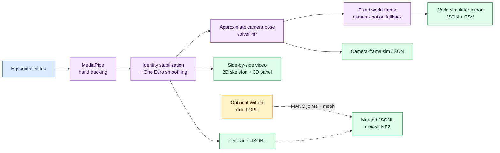
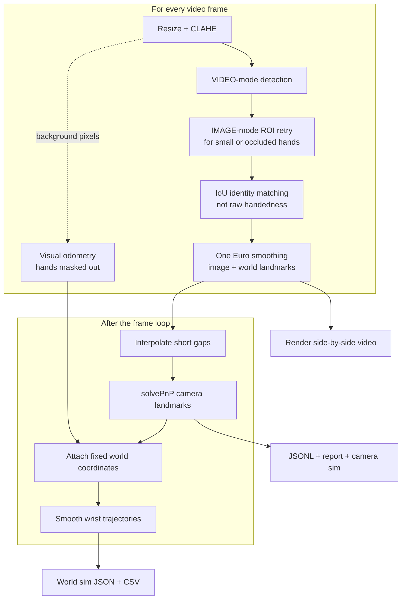
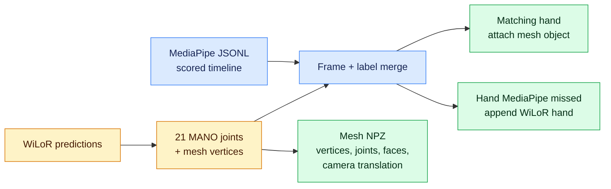

# PS4 — 3D hand motion from egocentric video

Track left and right hands with MediaPipe, smooth and stabilize identity across frames, and render a side-by-side video: source with a 2D skeleton plus a 3D panel from world (or approximate camera) landmarks. Exports per-frame JSONL, a metrics report, and sim-friendly wrist pose and finger curl angles.

Plan: [Notion — PS4 (24h)](https://www.notion.so/40aa9a9820cb818dbed3e37e150f2161)

## System at a glance



The primary scored timeline is MediaPipe. WiLoR adds higher-fidelity MANO geometry without replacing the MediaPipe landmarks.

## Data rules

Hackathon use only. Do not publish clips, frames, or screenshots. Do not commit video. `data/raw/` and `outputs/` are gitignored. Processed demos stay on a private Drive folder.

## Setup

```bash
python3.11 -m venv .venv
source .venv/bin/activate
pip install -r requirements.txt
bash scripts/download_models.sh
pytest -q
```

## Run

```bash
python scripts/run_ps4.py --input data/raw/your_clip.mp4
```

| Output | Description |
| --- | --- |
| `<name>_sidebyside.mp4` | Source + 2D skeleton beside 3D hand plot |
| `<name>.jsonl` | Per-frame landmarks (image, world, optional camera, optional world_fixed) |
| `<name>_report.json` | Detection share, FPS, dropouts, jitter, world-frame stats |
| `<name>_sim.json` | Wrist 6-DoF and finger curl angles for sim |
| `<name>_world_sim.json` | Fixed-world wrist trajectories (smoothed) + finger curls |
| `<name>_world_sim.csv` | Flat CSV of the same world trajectories for simulators |

**Side-by-side render layout**

```text
┌────────────────────────────────┬────────────────────────────────┐
│ SOURCE + 2D SKELETON           │ 3D HAND PANEL                  │
│ Left/right labels + FPS HUD    │ Camera or world landmarks      │
│ Tracked + interpolated hands   │ 21 joints + bone connections   │
└────────────────────────────────┴────────────────────────────────┘
```

Useful flags: `--max-frames 300`, `--no-clahe`, `--viz-max-side 960`, `--no-camera-pose`, `--max-gap 5`, `--no-world`, `--world-smooth-window 11`.

## Pipeline

MediaPipe Hand Landmarker (VIDEO mode) with CLAHE preprocessing, IoU-based left/right tracking, One Euro smoothing, gap fill up to 5 frames, optional `solvePnP` camera-frame landmarks, and Matplotlib 3D rendering.



## Fixed world frame + simulator export

On by default when camera pose is enabled (`--no-world` disables). A camera-motion
fallback estimates ego-motion with monocular visual odometry: LK feature tracking
on the background (tracked hands are masked out), `findEssentialMat` + `recoverPose`,
and per-frame pose composition. Rotation-dominant/low-parallax frames (where
`recoverPose` fails cheirality) fall back to homography-decomposition rotation
with no translation update. Failed frames carry the last pose forward and are
marked `valid=False`.


**Coordinate convention**

```text
                       +z forward
                          ↗
                         /
World = frame 0 camera  o ───────→ +x right
                        │
                        ↓
                     +y down
```

- World frame = camera at frame 0. Axes: +x right, +y down, +z forward (OpenCV).
- Rotation is exact; **translation is up-to-scale** (monocular scale ambiguity).
  Treat world positions as a consistent trajectory shape, not metric ground truth.
- Each hand gains `world_fixed` (21 joints) in the JSONL; each frame gains
  `camera_pose_world` (rotation, translation, valid).
- Wrist trajectories are smoothed (savgol on positions; sign-aligned savgol +
  renormalize on quaternions; small gaps lerp/Slerp-filled). The 21-joint
  `world_fixed` stays raw so the hand never deforms; only the exported wrist
  trajectory is smoothed.
- `<name>_world_sim.json` adds per-hand `wrist_xyz`, `wrist_quat_xyzw`,
  `finger_curls_rad` (rigid-invariant), `tracked`/`interpolated`/`smoothed`, plus
  `coordinate_frame` metadata. `<name>_world_sim.csv` is the flat row-per-hand
  version for direct simulator ingestion.

HaWoR is the optional heavier alternative to the fallback (same role as WiLoR for
mesh): a future GPU runner can supply its own per-frame camera trajectory to
`attach_world`, or write world-space hands directly into `world_fixed`, reusing
this export path unchanged.

## 3D mesh (WiLoR, cloud GPU)

WiLoR detects the hand and returns 21 MANO joints plus a mesh. Joints are written in the same per-frame JSONL as MediaPipe. Vertices go to `<name>_mesh.npz` (`mesh_index` on each hand). `--merge` attaches a `mesh` object onto the matching MediaPipe hand and appends hands MediaPipe missed.



```bash
bash scripts/setup_mesh_gpu.sh
python scripts/run_mesh.py --input data/raw/your_clip.mp4 --merge outputs/your_clip.jsonl
```

HaMeR is the heavier alternate (separate detector, own install). This runner uses WiLoR because one pass already yields joints and mesh. Python 3.10 on the GPU machine is the version WiLoR-mini tests.
